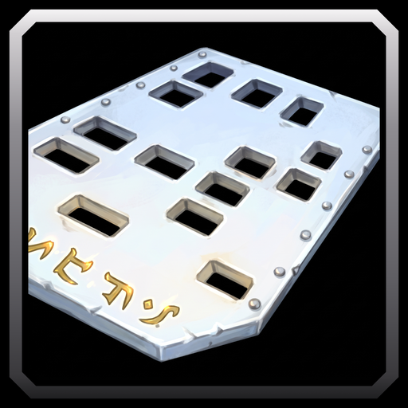

# Auction Stat Filter

Filter Auction House gear by stats, in Blizzard's Auction House and in Auctionator.

- **Pick** the stats you want, such as Strength, Spell Power or Defense
- **Search** as usual
- **See** gear without your stats fade out

## Why use it

- **The filter the Auction House lacks.** Blizzard's Auction House has no stat filter.
- **Works where you shop.** Blizzard's search results and Auctionator's Shopping tab.
- **Random suffixes count.** Gear of the Monkey counts the stats its suffix adds.

## Features

- A Stats button beside the Auction House's Filter button, sorted into Attributes, Attack, Spell and Defense
- A badge counts the stats you picked
- Match All keeps gear with every stat, Match Any gear with at least one
- Gear without your stats fades out, so you always see a filter is on
- Spell Power counts for every spell school
- Consumables, trade goods and other non-gear items always stay
- Your choice is kept for all your characters
- A first-time tip and tooltips show you around

## Quick start

1. Open the Auction House and click **Stats**, left of Filter, or left of Export Results in Auctionator's Shopping tab
2. Pick Match All or Match Any, then tick your stats
3. Search as usual
4. Click the red X on Stats to clear every stat

## Commands

- `/asf help` lists the commands
- `/asf intro` shows the welcome line and the Stats tip again

## Requirements

- Nothing. Auctionator is optional.
