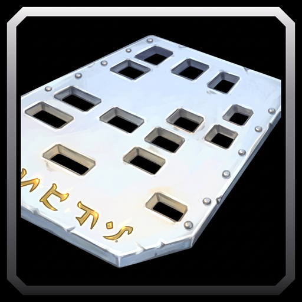

# Auction Stat Filter

A WoW Forever addon that filters Auction House results by the item stats you want, such as Strength, Spell Power or Defense. It works in Blizzard's Auction House and, if you use it, in Auctionator's Shopping tab.

## Features

- A Stats button beside the Auction House's own Filter button, with the stats sorted into Attributes, Attack, Spell and Defense.
- A badge on the Stats button counts the stats you picked.
- The first time you open the Auction House, a tip points you to the Stats button.
- Tooltips on Stats, its red X, Match All and Match Any explain what they do.
- Gear without your stats fades out, in Blizzard's search results and in Auctionator's Shopping tab, so you always see that a filter is on.
- Match All keeps gear with every stat you ticked, Match Any gear with at least one.
- Spell Power counts for every spell school.
- Items that are not gear, such as consumables and trade goods, always stay.
- Your choice is kept for all your characters.

## Usage

1. Open the Auction House and click Stats, left of Filter, or left of Export Results in Auctionator's Shopping tab.
2. Pick Match All or Match Any, then tick the stats you want.
3. Search as usual. Gear without your stats fades out.
4. Click the red X on Stats to clear every stat.

- `/asf help` lists the commands.
- `/asf intro` shows the welcome line and the Stats tip again.
